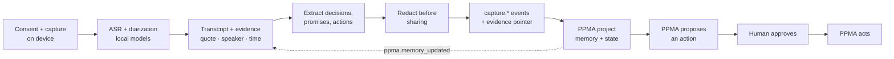

# RECALL

**Capture what was said, prove where it came from, and hand the facts to PPMA — so the project remembers, and the team can act.**

[**Play the 90-second recall →**](https://jiuwendemos.github.io/recall/#/stage) · [**Open the functional demo →**](https://jiuwendemos.github.io/recall/#/booth) · [**Ask the evidence →**](https://jiuwendemos.github.io/recall/#/recall)

[](https://github.com/jiuwendemos/recall/actions/workflows/ci.yml)
[](https://github.com/jiuwendemos/recall/actions/workflows/pages.yml)


| The 90-second piece | Ask the evidence |
| --- | --- |
|  |  |

| Attention — bounded proactivity | Memory canvas |
| --- | --- |
|  |  |


> *“The meeting is not lost.”*

RECALL is the private capture layer for a PPMA project. It records meetings, calls and field notes,
transcribes and diarizes on-device, extracts decisions, promises and actions, keeps the exact quote with
speaker, timestamp, confidence and source, redacts sensitive passages before sharing, and emits structured
facts to PPMA. Raw audio and video stay local by default.

**v1.1 completes all three layers in demo form:** a bounded attention engine (proactive, never autonomous), threaded
recall with voice input and a memory canvas (2026 interaction), and a real local PPMA server with signed
events, an openjiuwen adapter, an encrypted local store, safe share links and a connector catalogue (the
beginning of real integration). See [What’s new in v1.0](#whats-new-in-v10).

The public site is a **static, offline build** of the product UI, driven by a deterministic synthetic
pack. No customer audio, transcript or personal data is included. There is no network call after load by default; the optional local PPMA connection is explicitly configured by the user.

**Watch the end-to-end demo:** [`demo/video/recall-demo-en.mp4`](demo/video/recall-demo-en.mp4) — the
real Helios case, imported in **My workspace**, searched in Recall, sent to a running PPMA, and
analysed by a real openjiuwen agent.

## Workspace modes — demo or yours

The app has two explicit modes, switchable in **Settings → Workspace data** and visible in the top bar:

- **Synthetic demo** (default): the four scripted meetings, their transcripts, the seed events and the
  PPMA demo memory. Anything you create is shown alongside them.
- **My workspace (blank)**: only entries you create. The synthetic meetings, notes, events, memory and
  audit are hidden, not deleted. Switch back at any time.

A new capture in **My workspace** records consent, title and time but has **no transcript**, because
this public build does not run speech recognition. Field notes are genuinely your text, location and
optional photo filename. Nothing synthetic is substituted for your content.

---

## The 90-second stage piece

A meeting room. A phone on the table. The client asks: *“What did we promise them?”*

1. **Cold open** — the promise is lost in a call three weeks ago.
2. **Capture** — tap record; the transcript appears on-device.
3. **Recall** — search “delivery”; the exact quote, speaker and timestamp appear.
4. **Trust beat** — RECALL attributes the promise to the wrong speaker. The human corrects it; a
   `capture.correction` event updates the PPMA memory in the same scene.
5. **Audience choice** — share the clip, or redact the internal comment first. The room decides.
6. **Handoff** — PPMA moves the deadline, creates an action and drafts the follow-up.

**The line.** *“The meeting is not lost.”* Reset is one key, under five seconds.

---

## What is in this repository

| Surface | What it is | Route |
|---|---|---|
| **Stage piece** | Deterministic 90-second arc: record, recall, correct, redact, hand off. | [`/#/stage`](https://jiuwendemos.github.io/recall/#/stage) |
| **Booth demo** | A three-minute guided run with the whole data trail exposed. | [`/#/booth`](https://jiuwendemos.github.io/recall/#/booth) |
| **Now** | Recent captures, the attention strip, open promises, PPMA state and consent coverage. | [`/#/`](https://jiuwendemos.github.io/recall/#/) |
| **Attention** | Bounded proactive nudges: promises due, unsent handoffs, consent gaps, corrections, redaction reviews, retention, queue and device health. Accept, snooze, dismiss or mark wrong. | [`/#/attention`](https://jiuwendemos.github.io/recall/#/attention) |
| **Record** | Consent before capture, device state, live transcript, local model run, audio import. | [`/#/record`](https://jiuwendemos.github.io/recall/#/record) |
| **Meetings** | Every capture, status, consent, speakers, evidence, redactions and tombstones. | [`/#/meetings`](https://jiuwendemos.github.io/recall/#/meetings) |
| **Meeting workspace** | Transcript editing, speaker correction, extracted facts, comments/presence, redaction, evidence packs, share links, retention, deletion and PPMA events. | [`/#/meetings/mtg_delivery_1030`](https://jiuwendemos.github.io/recall/#/meetings/mtg_delivery_1030) |
| **Recall** | A threaded conversation with follow-ups, voice input, inline citations and an inspectable trace. It refuses when evidence is missing. | [`/#/recall`](https://jiuwendemos.github.io/recall/#/recall) |
| **Memory canvas** | Meetings, evidence, people and field notes as one inspectable graph. | [`/#/canvas`](https://jiuwendemos.github.io/recall/#/canvas) |
| **Connected services** | PPMA, openjiuwen, calendar, meetings, communication, CRM, work, knowledge, security and billing connectors with purpose, scopes and an off switch. | [`/#/connectors`](https://jiuwendemos.github.io/recall/#/connectors) |
| **Manager proof** | The 90-second and 10-minute manager run, metrics, privacy promise, naming decision and definition of done. | [/#/proof](https://jiuwendemos.github.io/recall/#/proof) |
| **Capability lab** | Every remaining roadmap surface: speech, OCR, translation, wearable/AR, rooms, identity, billing, connectors and gates, each with a working contract or deterministic simulator. | [`/#/lab`](https://jiuwendemos.github.io/recall/#/lab) |
| **PPMA north app** | Manifest, event log, local PPMA inbox, replay/idempotency, offline queue, commands, conformance and the live SSE stream. | [`/#/ppma`](https://jiuwendemos.github.io/recall/#/ppma) |
| **Field capture** | Offline-first notes, photo OCR, ambient controls, low-power mode, do-not-record zones and sync. | [`/#/field`](https://jiuwendemos.github.io/recall/#/field) |
| **Pilot dashboard** | The six gates, latency, useful extraction, funnel, baselines and the honest read. | [`/#/pilot`](https://jiuwendemos.github.io/recall/#/pilot) |
| **Admin** | Spaces, roles, devices, SSO, residency, compliance, billing, audit/eDiscovery, backup drills and the kill switch. | [`/#/admin`](https://jiuwendemos.github.io/recall/#/admin) |
| **Capture health** | Model cards, drift, device health, queue depth, memory hygiene, sync/conflict and the privacy runbook. | [`/#/health`](https://jiuwendemos.github.io/recall/#/health) |
| **Design system** | Tokens, type, record control, waveform, transcript, evidence, redaction, motion, glossary and accessibility. | [`/#/design`](https://jiuwendemos.github.io/recall/#/design) |
| **Share view** | A read-only, expiring safe-evidence page. No audio, no unredacted text. | [`/#/share/...`](https://jiuwendemos.github.io/recall/#/share) |
| **About** | The boundary with PPMA, the eight task families, NPU usage, business model and hard parts. | [`/#/about`](https://jiuwendemos.github.io/recall/#/about) |

The admin surface is visible when the role selector is set to **Privacy / legal** or **Admin**. The nav
deliberately hides what a role cannot act on.

---

## What’s new in v1.8

**RECALL now uses the real LAIX package**

- `laix@0.7.0` is vendored as a pinned tarball (`vendor/laix-0.7.0.tgz`) and added as
  `file:../vendor/laix-0.7.0.tgz`.
- The local `packages/laix-attention` and `packages/laix-decision-record` copies and their Vite
  aliases are gone.
- Attention goes **RECALL item → adapter → LAIX `decide` → RECALL UI**.
- Approval goes **RECALL approval → LAIX `createDecisionRecord` / `approveRecord` → RECALL UI**.
- LAIX’s verb is `guide`; the UI shows `LAIX · guide`. `notify` is no longer a LAIX action.
- See [`docs/laix-extraction.md`](docs/laix-extraction.md) for the boundary and the upgrade path.

## What’s new in v1.7

**The intelligence layer and the evidence workflow** — see the v1.6/v1.7 history below.

## What’s new in v1.6

**A real intelligence layer**

- **Intelligence tab** in the meeting workspace. Import a raw transcript, press **Analyze this
  capture**, and the local analysis runtime extracts decisions, actions, commitments, risks,
  contradictions, questions and gaps.
- **Every finding links to a quote**, speaker and timestamp. Missing owners and dates become gaps,
  not invented answers.
- **Proactivity from the analysis**: “N things need a human” on Home — runbook risk, thin support
  rota, unowned action, unanswered question.
- **Human authority**: approve findings, then send the safe facts to PPMA. The agent never writes to
  project memory on its own.
- The runtime is real and local: `server/src/analyzer.mjs` + `/v1/analyze` on the bridge, model
  `deepseek-v4-pro`, with latency and transcript-line trace shown in the app.

See [`docs/intelligence.md`](docs/intelligence.md) and the raw example
[`examples/real-case/case.raw.json`](examples/real-case/case.raw.json).

## What’s new in v1.5

**Import a real case in the app**

- **Record → Import a case** accepts the example JSON, `.vtt`, `.srt` or a plain transcript.
- The import is consent-gated and builds a real meeting: transcript, speakers, decisions, actions,
  questions and evidence.
- The imported case is searchable in **Recall**, opens in the meeting workspace and can be sent to PPMA.

## What’s new in v1.4

**A workspace that can be yours**

- **Settings → Workspace data** switches between the synthetic demo pack and **My workspace (blank)**.
- Personal mode hides every synthetic meeting, note, seed event, memory and audit entry; nothing is deleted.
- A new capture in personal mode records consent, title and time but **no transcript** — this build does not run
  ASR, so no synthetic transcript is substituted.
- Field notes are genuinely your text, location and optional photo filename.
- The top bar always shows which mode you are in.

**A real-case workflow**

- [`examples/real-case`](examples/real-case/README.md) includes a complete case: `case.example.json`,
  `transcript.txt`, `actions.csv`, field notes, agent questions and a real upload file.
- `scripts/ingest_case.py` turns your case into a real north-contract event, idempotently.
- The openjiuwen agent now has a `recall_case` tool, so it can analyse **your case file** and compare it with
  what PPMA actually kept.

## What’s new in v1.1

**Proactive, but bounded**

- a deterministic attention engine over promises, questions, consent, corrections, redactions, retention,
  queue and device health;
- a home attention strip, inline meeting nudges, a team digest, “why am I seeing this?” and
  accept / snooze / dismiss / “this is wrong” feedback;
- every nudge links to evidence and can never create a task, send a message or change project state.

**2026 interaction**

- threaded recall with follow-ups (“who said that?”, “show me the moment”, compare);
- voice input through the browser speech engine, with an explicit privacy note;
- a memory canvas of meetings, evidence, people and field notes;
- comments, presence and live corrections across open tabs through `BroadcastChannel`;
- role-based home, a first-run tour, a larger default type scale and a trust ribbon;
- a pre-send “What will PPMA receive?” preview and a deletion receipt;
- expiring safe share links, a PWA share target and a browser extension.

**Connected**

- a real local PPMA server in [`server/`](server/) with HMAC-signed events, dedupe, memory projection,
  corrections, redactions, tombstones, commands, SSE `ppma.memory_updated`, evidence search, evidence API,
  OpenAPI and `/v1/tools` for openjiuwen;
- a live browser client that signs and posts events with Web Crypto, and falls back to the local fake;
- an openjiuwen adapter with read-only and “prepare” tools — deliberately no execute/send/delete tool;
- an encrypted local store (AES-GCM, non-extractable key in IndexedDB) with migration from the legacy plain
  store;
- a connector catalogue with consent purpose, scopes, an off switch and per-connector test;
- an email draft (never sent), browser extension and safe evidence API.

**Still simulated:** ASR/diarization, NPU, OCR, vendor OAuth, billing and the synthetic meeting itself.
394 of 397 checkboxes are now checked at the real, contract or simulator level. The three open items are human validations: the real team pilot, the five-stranger test and the unprompted manager boundary test.

---

## The boundary that keeps RECALL and PPMA complementary

| Job | RECALL | PPMA |
|---|---|---|
| Capture audio / video / notes | **Owns** | Never |
| Transcribe, diarize, summarize | **Owns** | Consumes |
| Consent, redaction, media retention | **Owns** | Respects |
| Living project memory and state | Never | **Owns** |
| Tasks, calendar, email, missions | Never | **Owns** |
| Proactive action | Never | **Owns** |
| Evidence pack for a quote | **Owns** | Links to it |
| “What should happen next?” | Never | **Owns** |

RECALL never creates a task, schedules a meeting, sends a message or runs a mission. PPMA never records
or stores raw media. The contract is in [`docs/integration-ppma.md`](docs/integration-ppma.md).

---

## Run it locally

Requirements: Node 20+ (tested on Node 24), npm 10+.

```bash
cd web
npm install
npm run dev        # http://localhost:5184
npm test           # 20 local contract, attention and conversation tests
npm run build      # type-check + static build in web/dist
```

The real local PPMA server:

```bash
cd server
npm start          # http://localhost:8787
npm test           # 6 signed-event / memory / deletion tests
```

Then open **Connections**, enter `http://localhost:8787` and the shared secret
(`recall-demo-secret` by default), and press **Test connection**. Events are signed in the browser with
Web Crypto and posted to the server; the local fake remains the fallback.

The demo pack is generated deterministically from the script:

```bash
py scripts/build_demo_pack.py      # Windows
python3 scripts/build_demo_pack.py # macOS / Linux / CI
```

The pack is committed at `web/public/demo-pack.json`, so the site works offline and on a USB stick.
Deployment is GitHub Pages via `.github/workflows/pages.yml`. The browser extension lives in
[`extension/`](extension/).

---

## Architecture in one minute



All state lives in the browser for the demo, with `localStorage` persistence, a consent gate in the
store, an offline queue, idempotent event delivery and a local PPMA fake that applies corrections,
redactions, consent withdrawal and tombstones. See [`docs/architecture.md`](docs/architecture.md).

---

## What is real and what is simulated

**Real in this build:** the 90-second stage state machine, consent gating, transcript editing, speaker
correction, redaction with safe-version preview, evidence packs with hashes, retention and legal hold
controls, deletion tombstones, PPMA event envelopes, idempotency/duplicate detection, offline queue,
audit export, role-based navigation, English/Chinese UI, dark/paper/high-contrast themes, offline PWA
shell, deterministic tests, the attention engine, threaded recall, memory canvas, comments/presence,
expiring share links, AES-GCM encrypted local storage, the local PPMA server with signed events, and the
openjiuwen adapter contract.

**Verified live on 30 October 2026:** a running PPMA backend at `127.0.0.1:8770` accepted RECALL's
north-contract manifest and a real `capture.meeting.completed` event, rejected a replay as a duplicate,
and exposed its memory view; a local bridge carried the browser traffic; and a real openjiuwen DeepAgent
(`deepseek-v4-pro`) called RECALL tools and answered from PPMA memory. Reproduce it with
[`docs/integration-live.md`](docs/integration-live.md).

**Simulated for the public demo:** the scripted 14-minute meeting and its 119 transcript rows, the
ASR/diarization outputs, the on-device OCR result, the vendor OAuth connectors, pilot metrics and
admin/billing data. The microphone is not opened, and the audio timeline is a visualisation - no audio is
included. The public GitHub Pages build uses the local fake by default because it is static and cannot
host PPMA or the model runtime. Production swap points (real NPU runtime, host identity provider, vendor
credentials, multi-device sync, billing) are named in [`docs/architecture.md`](docs/architecture.md).

**Never:** training on customer audio or transcripts, raw media in the cloud by default, silent
deletion, or capture without a recorded consent state.

---

## Tests

`web/src/lib/engine.test.ts` covers the promises that keep the product trustworthy:

- the promise is the top result for “delivery”;
- an answer cites evidence and refuses when there is none;
- a deleted memory is not answered from;
- no event is emitted without consent;
- speaker correction updates the transcript and attribution;
- redaction swaps the safe text and never sends the raw internal comment;
- deletion leaves a tombstone and removes the transcript;
- event ids are stable and duplicates are rejected;
- an evidence pack contains speaker, timestamp, source, consent and a hash.

```bash
cd web && npm test
cd server && npm test
```

`web/src/lib/attention.test.ts` covers the bounded attention engine and suppression. 
`web/src/lib/conversation.test.ts` covers follow-up context, review-only actions and refusal in a thread.
`server/test/server.test.mjs` covers signature rejection, signed completion, duplicate rejection, memory
projection, correction, redaction, tombstone and the command inbox.

The CI also regenerates the pack and fails if the committed pack is not reproducible, and runs the local
PPMA server suite.

---

## Data rights and provenance

- Synthetic pack, fixed seed `20261030`. No customer audio, transcript or personal data.
- The local store is encrypted with AES-GCM and a non-extractable key in IndexedDB; the legacy plain store is migrated and removed.
- Fonts (Fraunces, Inter, JetBrains Mono) are bundled locally. No font, icon or CDN calls.
- Icons are in-house SVG.
- The service worker and all assets are relative, so the build works under `/recall/` or from a folder.
- The local PPMA server signs events with HMAC and stores only safe derived facts; it has no raw-media endpoint.
- Licence: MIT. See [`LICENSE`](LICENSE) and [`docs/provenance.md`](docs/provenance.md).

---

## Documentation

- [Manager proof](https://jiuwendemos.github.io/recall/#/proof) — the 90-second and 10-minute manager run, metrics, privacy and boundary.
- [Naming decision](docs/naming.md) - RECALL vs the PPMA `recall` memory view.
- [Live integration](docs/integration-live.md) - the exact commands that ran PPMA and the openjiuwen agent.
- [Integration status](docs/integration-status.md) - every external dependency, why it is needed and what the app does with it.
- [Intelligence layer](docs/intelligence.md) - raw transcript → evidence-linked findings → proactive risk → human approval → PPMA.
- [LAIX integration](docs/laix-extraction.md) - the `laix` package, the adapter boundary and the upgrade path.
- [Real-case example](examples/real-case/README.md) - what to fill in, which files to upload, and how to ingest and analyse your own case.
- [Concept](docs/concept.md) — what RECALL is, what it is not, the buyer, the business model.
- [Roadmap](docs/roadmap.md) — 0A through Phase 6 plus the three v1 tracks; 394 implemented and 3 external validations.
- [PPMA × RECALL contract](docs/integration-ppma.md) — events, commands, consent, deletion, idempotency.
- [Architecture](docs/architecture.md) — state machine, store, event pipeline, security, production swaps.
- [Local PPMA server](server/README.md) — signed events, memory, commands, SSE and the openjiuwen adapter.
- [Stage script](docs/stage-script.md) — the 90 seconds, props, reset, fallback and rehearsals.
- [Design audit & research](docs/design-audit.md) — responsive audit, WCAG, budgets and the pilot research gate.
- [Accessibility audit](docs/accessibility.md) — route scores, keyboard paths and the screen-reader script.
- [Safe evidence API](docs/evidence-api.md) — public evidence-pack contract.
- [Vendor register](docs/vendor-register.md) — connector purpose, direction, data posture and DPA status.
- [Capability lab](https://jiuwendemos.github.io/recall/#/lab) — every simulator and contract surface, runnable.
- [Provenance](docs/provenance.md) — assets, synthetic data, reproducibility and the public-demo boundary.

All **366 base checkboxes** are checked, and the new manager-proof/SD additions add 25 checked items and 3 external human validations. Each is real, a contract with a mock provider, or a deterministic
simulator exposed in the Capability lab. See
[Beyond v0.9.0](docs/roadmap.md#beyond-v090--the-three-tracks).

---

**The meeting is not lost.**
